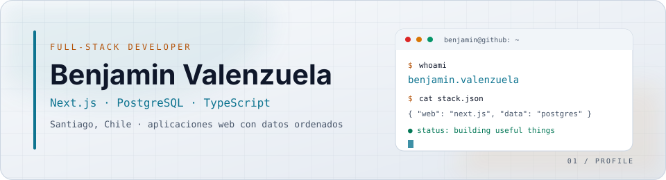
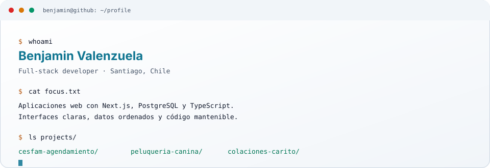

<picture>
  <source media="(prefers-color-scheme: dark)" srcset="assets/banner-dark.svg">
  <source media="(prefers-color-scheme: light)" srcset="assets/banner-light.svg">
  
</picture>

 

<picture>
  <source media="(prefers-color-scheme: dark)" srcset="https://readme-typing-svg.demolab.com?font=JetBrains+Mono&amp;weight=600&amp;size=22&amp;duration=2800&amp;pause=900&amp;color=22D3EE&amp;center=true&amp;vCenter=true&amp;width=900&amp;lines=Benjamin+Valenzuela+%E2%80%94+Full-Stack+Developer;Next.js+%7C+PostgreSQL+%7C+TypeScript;Aplicaciones+web+claras+y+mantenibles;Santiago%2C+Chile">
  
</picture>

  

---

## `$ whoami`

  <picture>
    <source media="(prefers-color-scheme: dark)" srcset="assets/terminal-dark.svg">
    <source media="(prefers-color-scheme: light)" srcset="assets/terminal-light.svg">
    
  </picture>

---

## `$ cat stack.yml`

| Frontend | Backend y datos | Herramientas |
| :--- | :--- | :--- |
|  `Next.js · React · TypeScript · Tailwind · HTML · CSS` |  `Node.js · PostgreSQL · Prisma · NextAuth · REST` |  `Git · GitHub · Vercel · Docker · Linux` |

---

## `$ ls projects/`

| Proyecto | Qué resuelve | Stack | Links |
| :--- | :--- | :--- | :--- |
| **CESFAM** | Agendamiento de horas médicas para centros de salud familiar. | `Next.js` `PostgreSQL` `NextAuth` `Prisma` | [Demo](https://cesfam-agendamiento.vercel.app) · [Código](https://github.com/BenVal2/cesfam-agendamiento) |
| **Peluquería Canina** | Landing con cotizador de servicios y agendamiento por WhatsApp. | `HTML` `CSS` `JavaScript` | [Demo](https://benval2.github.io/peluqueria-canina/) · [Código](https://github.com/BenVal2/peluqueria-canina) |
| **Colaciones Carito** | Menú digital con pedido por WhatsApp para una pollería. | `HTML` `CSS` `JavaScript` | [Demo](https://benval2.github.io/colaciones-carito/) · [Código](https://github.com/BenVal2/colaciones-carito) |

---

## `$ contact`

&nbsp;

 

Full-stack · Next.js · PostgreSQL · TypeScript · Santiago, Chile

